# Manuscript figure gallery

This archive follows the figure numbering and panel order in the supplied
30-page manuscript, *Weighted interpolatory Tucker approximation of
range-separated potentials*. The original figure pixels are preserved,
including any legacy figure numbers printed inside the plots. The repository
filenames follow the manuscript's actual figure numbers, not those legacy
labels.

These are the supplied paper figures, not newly measured outputs. The
comparison panels are retained only as historical manuscript results:
the repository's MATLAB drivers implement RC-TLR, not ChebTuck. Running
`reproduce_all()` generates RC-TLR results in a separate results directory.
The archived three-box experiment uses strong RRQR tolerance 4e-8; the
standard biomolecular and lattice results in the manuscript use 1e-7,
whereas the current biomolecular driver defaults to 4e-8. To run the
RC-TLR biomolecular studies using the manuscript's stated tolerance:

```matlab
addpath('experiments/biomolecular','-begin');
opts = struct('qrTol',1e-7,'target',1e-7, ...
    'outDir',fullfile(pwd,'results','biomolecular_manuscript'));
out = run_biomol_paper([],opts);
```

In each surface plot, vertical and color scales are panel-specific. Numerical
maximum errors reported in the captions below refer to the complete middle
slice as specified in the manuscript, not just displayed plotting samples.
See [the manifest](manifest.csv) for original filenames, panel positions
and file checksums.

## Figure 1 — Effect of quadrature weighting (p. 12, Section 3.3)

Three-box kernel approximation on uniform 20 by 20 planar grids in each of
the three boxes, with p=2,...,8 Chebyshev nodes per coordinate. The relative
Frobenius error (upper left) uses the entire 400-by-400-by-400 validation
tensor, and the dashed line is the target 1e-7. The stored scalar count
(upper right) includes the selected core, interpolation maps and basis
matrices. The lower panel measures construction time, excluding reconstruction
and validation. At p=8 all three methods meet the error target; weighted
RC-TLR uses 13,748 scalars, compared with 15,284 for unweighted RC-TLR and
16,950 for grouped ChebTuck (manuscript Table 1).

| Upper left: relative Frobenius error | Upper right: stored scalars |
|---|---|
| 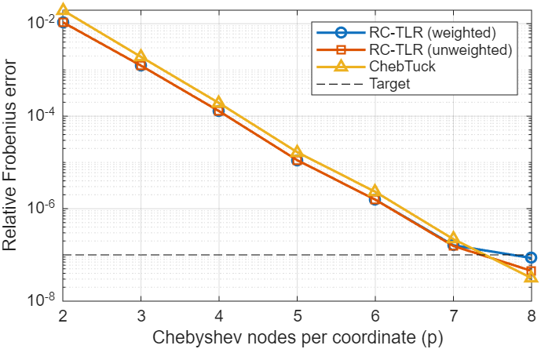 | 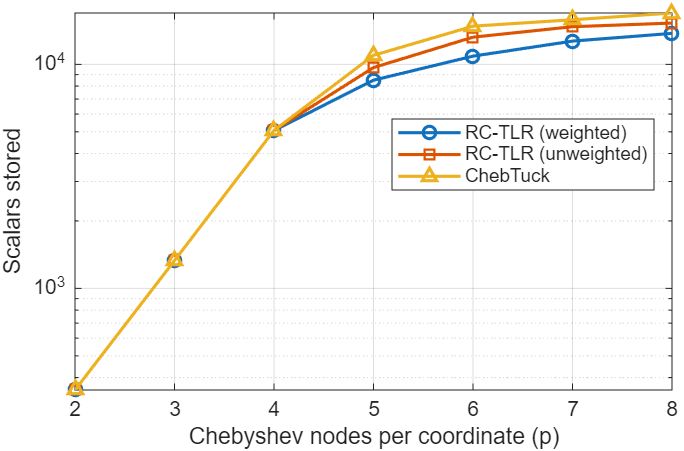 |

**Bottom: construction time**

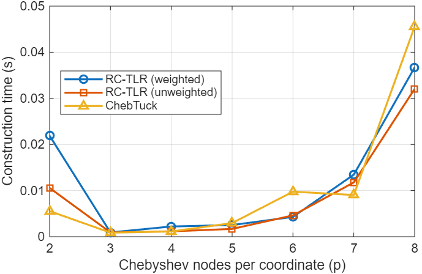

## Figure 2 — Supplied long-range biomolecular input (p. 16, Section 5.1)

The 500-atom fragment's long-range CP tensor at n=1024, with 832 canonical
terms. The left image is its middle slice; the right shows the first ten
x-direction CP factors. As noted in the manuscript, these factors coincide,
so their plotted curves overlap.

| Left: input middle slice | Right: x-direction CP factors |
|---|---|
| 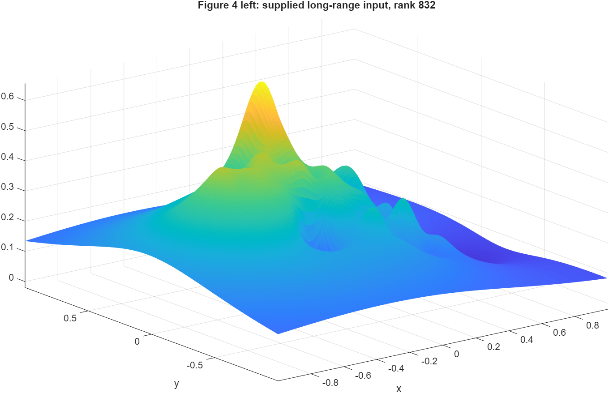 | 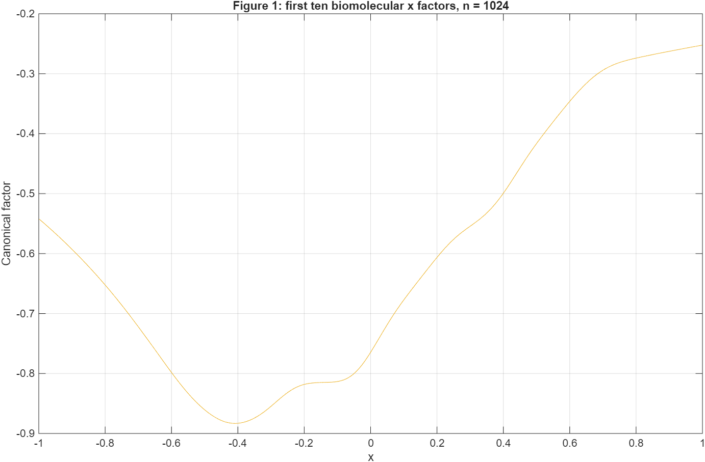 |

## Figure 3 — CP-input spline approximation (p. 17, Section 5.1)

For n=256, N=500 and p=129, each row displays the approximated middle
slice, signed compression error (compressed approximation minus the
uncompressed Chebyshev interpolant) and signed total error (compressed
approximation minus the supplied CP reference), left to right. The
compression-error scale is near machine precision, while the total error
is on the order of 1e-7 in these plots; interpolation dominates.

**Top: ChebTuck**

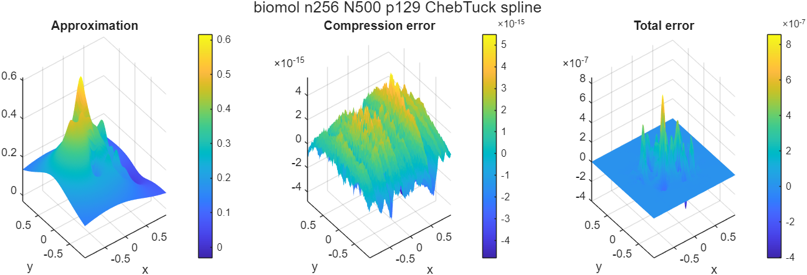

**Bottom: RC-TLR**

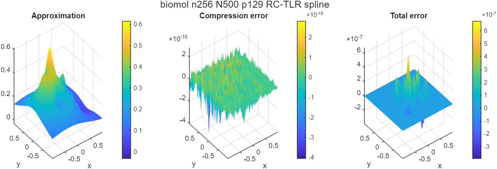

## Figure 4 — ChebTuck grid refinement (p. 18, Section 5.1)

Total signed errors of the cubic-spline CP-input baseline for n=512,
1024 and 2048 (left to right), with N=500 and p=129. The vertical scale
changes between panels.

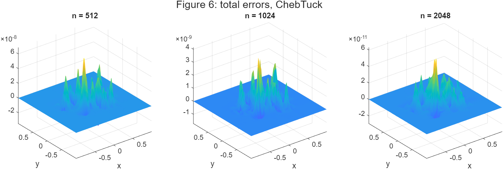

## Figure 5 — RC-TLR grid refinement (p. 18, Section 5.1)

Total signed errors for the same three grid sizes, atom count and node
count. The manuscript reports complete-middle-slice absolute maximum
errors 5.13e-8, 4.51e-9 and 6.31e-11, respectively.

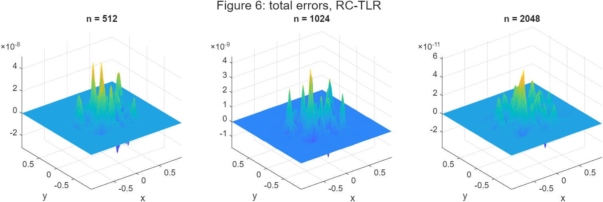

## Figure 6 — ChebTuck factor interpolation (p. 19, Section 5.1)

At n=2048, N=500 and p=129, the total signed error is displayed for cubic
spline, piecewise-linear and nearest-neighbor factor interpolation, left to
right. Manuscript Table 8 reports absolute middle-slice maximum errors
6.366e-11, 8.377e-6 and 1.412e-3, respectively.

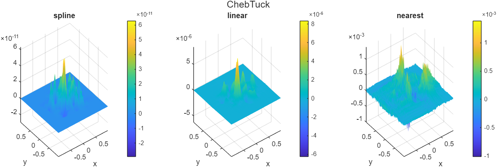

## Figure 7 — RC-TLR factor interpolation (p. 19, Section 5.1)

The same interpolation choices and parameters for RC-TLR. Manuscript
Table 8 reports maximum absolute errors of 6.312e-11, 8.213e-6 and 1.566e-3
for cubic spline, piecewise linear and nearest neighbor, respectively.
These plots illustrate why the spline choice matters even when the core
dimensions and storage remain unchanged.

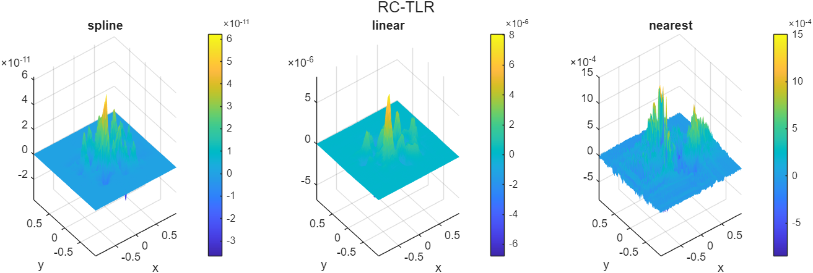

## Figure 8 — Fragment-size scaling (p. 20, Section 5.2)

Maximum retained Tucker mode rank (left) and continuous representation
storage (right) against N=100,200,...,600 atoms, with n=2048 and p=129.
Continuous storage counts the core plus p times the sum of the three
mode ranks. Both methods have identical ranks and continuous storage at
these settings, so their curves coincide. The maximum rank rises from
26 to 33 as N increases sixfold.

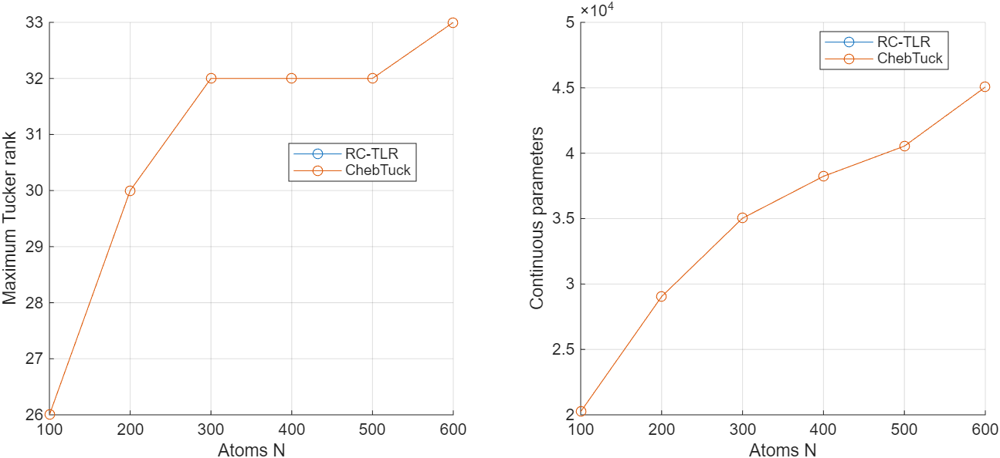

## Figure 9 — Mode-2 coefficient-factor spectra (p. 21, Section 5.2)

For all six fragment sizes at n=2048 and p=129, the left panels show the
full mode-2 coefficient-factor singular-value spectra and the right panels
zoom to indices 10–40. The first singular value below 1e-15 occurs at
indices 22, 25, 25, 27, 29 and 31, respectively, for both methods, as
reported in the manuscript. These are CP coefficient-factor spectra, not
singular values of the weighted tensor unfoldings.

**Top: ChebTuck**

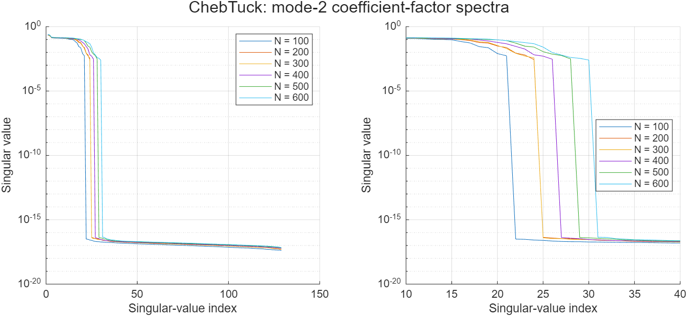

**Bottom: RC-TLR**

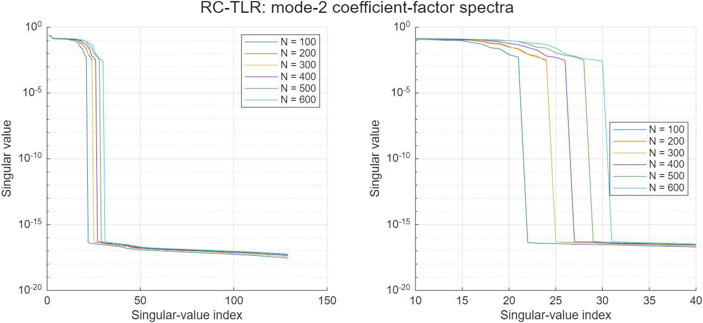

## Figure 10 — Supplied long-range lattice input (p. 22, Section 5.3)

For n=960 and N=2304, the retained long-range input comprises 28 canonical
terms (50 original terms minus 22 short-range terms). The left panel shows
the potential middle slice; the right panel shows the first ten x-direction
canonical factors.

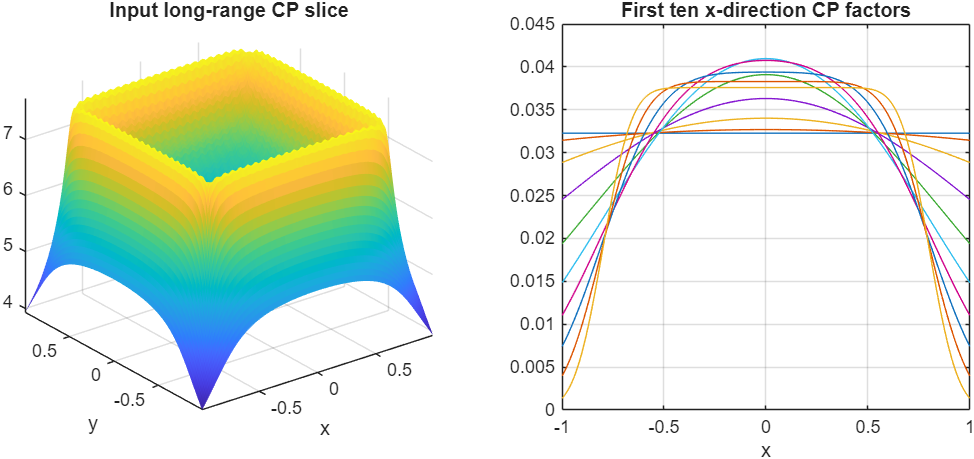

## Figure 11 — Lattice approximation (p. 23, Section 5.3)

With n=960, N=2304 and p=129, the three columns show the approximated middle
slice, signed compression error and signed total error, respectively.
Manuscript Table 13 reports core dimensions 18-by-18-by-12 for ChebTuck
and 15-by-15-by-10 for RC-TLR, and relative middle-slice maximum errors
2.0711e-7 and 1.9839e-7, respectively. Both results exceed the nominal
1e-7 relative error target.

**Top: ChebTuck**

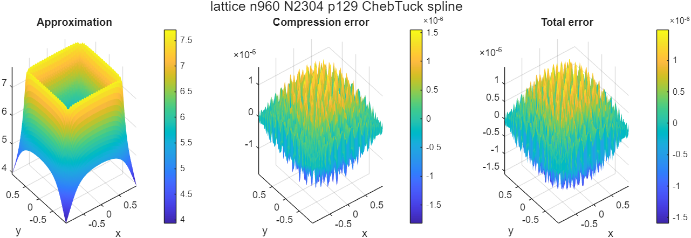

**Bottom: RC-TLR**

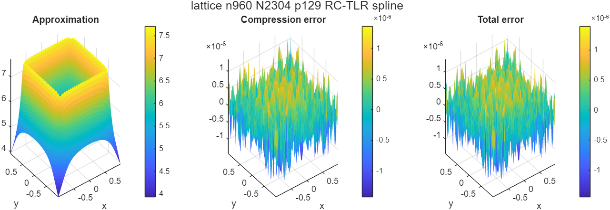
